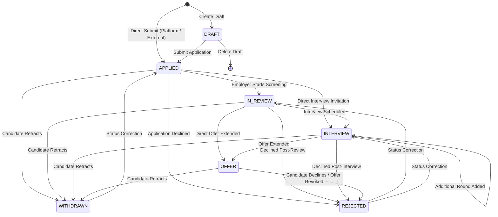
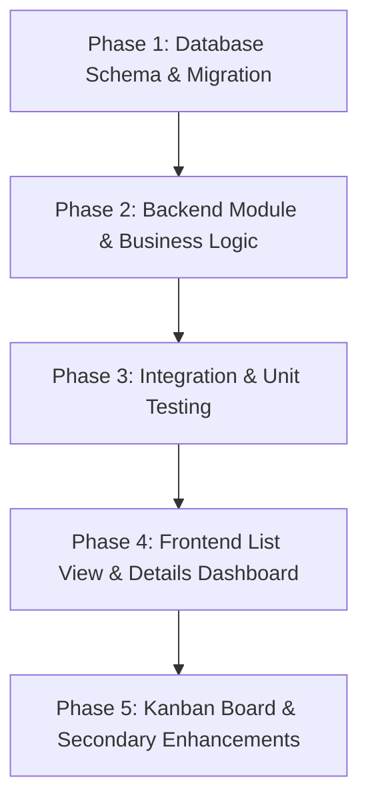

# Application Tracking System — Architectural Specification & Implementation Plan

**Status:** Finalized Planning & Specification (Ready for Implementation)\
**Author:** DeepMind Agentic Pair Programmer & Antigravity Assistant\
**Target Stack:** Node.js, Express.js, TypeScript, MySQL / MariaDB, PostgreSQL, Prisma ORM, Next.js (App Router), Tailwind CSS (Stormy Morning Design System).

---

## 1. Executive Summary & Context

This document defines the comprehensive architecture, data models, API contracts, security controls, and user experience flows for the **Application Tracking System (ATS)** in the Job Aggregation Platform.

### Core Objectives
1. **Unified Application Management:** Enable job seekers to organize, track, and advance all their job applications in one place—supporting both jobs discovered on the platform and manually entered external job applications.
2. **Definitive Status Lifecycle:** Establish an explicit 7-stage state machine (`DRAFT`, `APPLIED`, `IN_REVIEW`, `INTERVIEW`, `OFFER`, `REJECTED`, `WITHDRAWN`) with server-side validation and full audit history.
3. **Document Snapshot Integrity:** Permanently preserve the exact version of the CV and cover letter used at the moment of submission, guaranteeing that subsequent profile edits never alter submitted application records.
4. **Multi-Round Interview Tracking:** Provide candidate-friendly tracking of multiple interview rounds per application with timezone-aware scheduling, meeting details, interviewer information, and outcome logs.
5. **List-First Dashboard Experience:** Build a fast, filterable, and accessible primary list view with aggregate metrics, search, sorting, and detail views, followed by an optional visual Kanban board.
6. **Zero Regression Guarantee:** Maintain complete backward compatibility with existing users, catalog jobs, saved jobs, documents, and authentication systems.

---

## 2. Product Decisions & Business Rules

### 2.1 Application Statuses & State Machine

Every application has a single primary status from the following enum:

| Status | Code | Description | Candidate Action |
|---|---|---|---|
| **Draft** | `DRAFT` | Application being prepared; not yet submitted. | Edit, submit, or delete draft. |
| **Applied** | `APPLIED` | Application has been submitted to the employer. | Withdraw or log employer response. |
| **In Review** | `IN_REVIEW` | Employer/recruiter is actively screening the application. | Await response or withdraw. |
| **Interview** | `INTERVIEW` | One or more interview rounds have been scheduled/conducted. | Schedule rounds, add notes, record outcome. |
| **Offer** | `OFFER` | Formal job offer received from employer. | Accept, decline, or negotiate. |
| **Rejected** | `REJECTED` | Candidate was not selected for this position. | View feedback, archive record. |
| **Withdrawn** | `WITHDRAWN` | Candidate voluntarily retracted application. | Reapply if position reopens. |



#### Valid Transition Matrix & Validation Rules

```ts
const VALID_TRANSITIONS: Record<ApplicationStatus, ApplicationStatus[]> = {
  DRAFT: ['APPLIED', 'WITHDRAWN'],
  APPLIED: ['IN_REVIEW', 'INTERVIEW', 'REJECTED', 'WITHDRAWN'],
  IN_REVIEW: ['INTERVIEW', 'OFFER', 'REJECTED', 'WITHDRAWN', 'APPLIED'], // APPLIED allowed for mistake correction
  INTERVIEW: ['INTERVIEW', 'OFFER', 'REJECTED', 'WITHDRAWN', 'IN_REVIEW'],
  OFFER: ['REJECTED', 'WITHDRAWN', 'INTERVIEW'],
  REJECTED: ['IN_REVIEW', 'INTERVIEW', 'APPLIED'], // Mistake correction with audit note
  WITHDRAWN: ['APPLIED'], // Graceful mistake correction
};
```

1. **Server-Side Enforcement:** Every status update is validated against `VALID_TRANSITIONS`. Attempting an illegal jump (e.g. `DRAFT -> OFFER`) returns HTTP `400 BAD_REQUEST (INVALID_STATUS_TRANSITION)`.
2. **Mistake Correction Safeguard:** Reverting from a terminal status (`REJECTED`, `WITHDRAWN`) requires an optional `reason` parameter and is recorded as a correction event in `JobApplicationHistory`.
3. **Immutable History Audit:** Every change in status triggers an automatic insertion into `JobApplicationHistory` recording the `fromStatus`, `toStatus`, `changedByUserId`, `changeReason`, and timestamp.

---

### 2.2 Application Sources (Platform vs. External)

Applications explicitly declare their origin via `source: ApplicationSource`:

```prisma
enum ApplicationSource {
  PLATFORM
  EXTERNAL
}
```

1. **Platform Applications (`PLATFORM`):**
   - Attached to a verified platform job opening (`jobId` is required).
   - Inherits verified metadata: job title, company name, location, salary range, category, and source platform.
   - Enforces email verification (`isEmailVerified === true`).
   - Validates that the platform job is `ACTIVE` and deadline has not passed.
2. **External Applications (`EXTERNAL`):**
   - Candidate tracked an opportunity from an outside source (e.g., LinkedIn, company career page, personal referral).
   - `jobId` is `NULL`.
   - Candidate records:
     - `externalCompanyName` (Required, 1-255 chars)
     - `externalJobTitle` (Required, 1-255 chars)
     - `externalJobUrl` (Optional URL, validated against SSRF/loopback protocols)
     - `externalLocation` (Optional, e.g. "Addis Ababa", "Remote")
     - `externalSalary` (Optional, e.g. "45,000 ETB / month")
     - `appliedAt` (User-selectable date when applied)
     - `notes` (Free-form preparation or submission notes)
3. **Outbound Link Rule:** Opening an external link from `/jobs/:id` does **not** create an application. An external application record is created only when the user explicitly clicks *"Track this application"* or fills out the external application form.

---

### 2.3 Reapplication and Duplicate Prevention

1. **Active Application Guard:**
   - A user cannot maintain two **active** applications (`DRAFT`, `APPLIED`, `IN_REVIEW`, `INTERVIEW`, `OFFER`) for the same platform job (`jobId`).
   - If an active application exists, attempts to re-apply return HTTP `409 CONFLICT (APPLICATION_ALREADY_EXISTS)`.
2. **Reapplication Permitted After Withdrawal:**
   - If a candidate previously marked an application as `WITHDRAWN`, they are permitted to submit a new application for the same platform job if the posting remains open.
   - The historical withdrawn record is preserved in full; the new application receives a unique `id` and fresh timeline.
3. **Separate Openings at Same Company:**
   - Multiple applications to different job postings (`jobId_A` vs `jobId_B`) at the same company are explicitly permitted.
4. **External Duplicate Warning:**
   - For external jobs, if the user tries to create an application with matching `(userId, externalCompanyName, externalJobTitle)` in an active status, the API warns the user or rejects accidental double-clicks.
5. **Concurrency & Idempotency Safeguards:**
   - API endpoints accept an optional `Idempotency-Key` header.
   - Application creation runs in a database transaction (`prisma.$transaction`) with a compound check to prevent race conditions from concurrent duplicate clicks.

---

### 2.4 Deletion, Retention & Immutability

1. **Draft Deletion:**
   - Candidates may delete `DRAFT` applications via `DELETE /api/v1/applications/:id`.
   - Physical deletion cascades only to unsubmitted draft notes and draft reminders.
2. **Submitted Application Retention:**
   - Applications that have reached `APPLIED` or beyond **cannot be physically deleted** through the regular application endpoints.
   - Attempting `DELETE` on a submitted application returns HTTP `400 BAD_REQUEST (CANNOT_DELETE_SUBMITTED_APPLICATION)`.
   - To hide an inactive application from active view, candidates use **Withdraw** or **Archive** (`isArchived: true`).
3. **Document Snapshot Preservation:**
   - When an application is submitted, the platform stores a snapshot reference:
     - `documentId`: References the `UserDocument.id`.
     - `documentSnapshotFilename`: Original file name (e.g. `Abrsh_Resume_2026.pdf`).
     - `documentSnapshotChecksum`: SHA-256 hash of the submitted document.
     - `coverNoteText`: Complete snapshot of cover letter / application message.
   - Even if the candidate later deletes or replaces their CV in `/profile` or `/documents`, the original document file referenced by `documentId` is protected from deletion and remains permanently accessible through the application record.

---

### 2.5 Multi-Round Interview Tracking & Reminders

Each application supports an ordered series of interview rounds:

1. **Multiple Rounds Support:** 
   - Round 1: Recruiter Phone Screen
   - Round 2: Technical Assessment / Take-home
   - Round 3: System Design / Coding Interview
   - Round 4: Hiring Manager / Culture Fit
   - Round 5: Final Executive / Partner Interview
2. **Timezone-Aware Scheduling:**
   - Stored in database as UTC `DateTime` (`scheduledAt`).
   - Explicit `timezone` string recorded (e.g., `Africa/Addis_Ababa`, `UTC`, `America/New_York`).
   - UI converts and displays in candidate's local browser timezone with clear timezone label.
3. **Meeting Metadata:**
   - Optional location / meeting link (Google Meet, Zoom, Microsoft Teams, or physical office address).
   - Interviewer names and titles.
   - Pre-interview preparation notes.
   - Post-interview debrief notes and outcome (`PENDING`, `PASSED`, `FAILED`, `CANCELLED`).
4. **Follow-Up Reminders (Separate Entity):**
   - Reminders are decoupled from interview events (e.g. "Send thank you note 24 hours post-interview", "Check in on offer letter next Monday").
   - Includes `remindAt`, `title`, `isCompleted`, and `completedAt`.

---

### 2.6 Dashboard & UX Architecture

The dashboard experience is built **List View First**:

1. **Primary List View (`/jobs/applications`):**
   - Summary Metric Counters:
     - Total Applications
     - Active Applications (`APPLIED` + `IN_REVIEW`)
     - Upcoming Interviews
     - Offers Received
   - Filter & Search Bar:
     - Search input (company, job title, notes)
     - Status tabs (`All`, `Active`, `Draft`, `Applied`, `In Review`, `Interview`, `Offer`, `Rejected`, `Withdrawn`)
     - Source filter (`All`, `Platform`, `External`)
     - Sorting: `Newest Applied`, `Oldest Applied`, `Next Interview Date`, `Company A-Z`
   - Responsive Data Cards / Table:
     - Title, company, location, source badge.
     - Status badge styled with Stormy Morning semantic colors.
     - Application date and next scheduled interview indicator.
     - Quick action buttons (View Details, Update Status, Schedule Interview).
   - Primary Action:
     - "Add External Application" CTA button opening the creation modal.
   - Pagination: 15 applications per page with standard Next/Prev controls.
2. **Application Detail View (`/jobs/applications/[id]`):**
   - Header with status badge, company, job link, and actions (Update Status, Withdraw, Delete Draft).
   - Visual Timeline (`JobApplicationHistory` stepper).
   - Submitted Materials Section (Download snapshot CV, view cover letter).
   - Interview Rounds Section (List of rounds with status, notes, meeting links, and "Add Round" modal).
   - Follow-up Reminders & Notes.
3. **Secondary Kanban View (Phase 2 UI):**
   - Visual board with columns: `Wishlist/Draft` $\rightarrow$ `Applied` $\rightarrow$ `In Review` $\rightarrow$ `Interview` $\rightarrow$ `Offer`.
   - Collapsible drawer for `Rejected` and `Withdrawn`.

---

## 3. Database Schema Design (Prisma)

### 3.1 Proposed Prisma Schema Extension

```prisma
// ============================================================================
// Application Tracking Enums
// ============================================================================

enum ApplicationStatus {
  DRAFT
  APPLIED
  IN_REVIEW
  INTERVIEW
  OFFER
  REJECTED
  WITHDRAWN
}

enum ApplicationSource {
  PLATFORM
  EXTERNAL
}

enum InterviewType {
  PHONE
  VIDEO
  IN_PERSON
  TAKE_HOME
  OTHER
}

enum InterviewOutcome {
  PENDING
  PASSED
  FAILED
  CANCELLED
}

// ============================================================================
// Application Tracking Models
// ============================================================================

model JobApplication {
  id                        String              @id @default(uuid())
  userId                    String              @map("user_id")
  user                      User                @relation(fields: [userId], references: [id], onDelete: Cascade)
  
  // Platform Job Association (Optional for External Applications)
  jobId                     String?             @map("job_id")
  job                       Job?                @relation(fields: [jobId], references: [id], onDelete: SetNull)
  
  // Application Classification & Source
  source                    ApplicationSource   @default(PLATFORM)
  status                    ApplicationStatus   @default(APPLIED)
  
  // External Job Fields (Populated when source === EXTERNAL)
  externalCompanyName       String?             @map("external_company_name") @db.VarChar(255)
  externalJobTitle          String?             @map("external_job_title") @db.VarChar(255)
  externalJobUrl            String?             @map("external_job_url") @db.VarChar(1000)
  externalLocation          String?             @map("external_location") @db.VarChar(255)
  externalSalary            String?             @map("external_salary") @db.VarChar(100)
  
  // Submitted Document Snapshots
  documentId                String?             @map("document_id")
  document                  UserDocument?       @relation(fields: [documentId], references: [id], onDelete: SetNull)
  documentSnapshotFilename  String?             @map("document_snapshot_filename") @db.VarChar(255)
  documentSnapshotChecksum  String?             @map("document_snapshot_checksum") @db.VarChar(64)
  coverNoteText             String?             @map("cover_note_text") @db.Text
  
  // General Notes & Lifecycle
  notes                     String?             @db.Text
  isArchived                Boolean             @default(false) @map("is_archived")
  activeKey                 String?             @unique @map("active_key") @db.VarChar(255) // Concurrency & reapplication guard: ${userId}_${jobId} when active
  
  // Timestamps
  appliedAt                 DateTime            @default(now()) @map("applied_at")
  createdAt                 DateTime            @default(now()) @map("created_at")
  updatedAt                 DateTime            @updatedAt @map("updated_at")

  // Relational Child Records
  history                   JobApplicationHistory[]
  interviews                JobApplicationInterview[]
  reminders                 JobApplicationReminder[]

  @@index([userId])
  @@index([jobId])
  @@index([status])
  @@index([source])
  @@index([isArchived])
  @@index([appliedAt])
  @@map("job_applications")
}

model JobApplicationHistory {
  id              String            @id @default(uuid())
  applicationId   String            @map("application_id")
  application     JobApplication    @relation(fields: [applicationId], references: [id], onDelete: Cascade)
  fromStatus      ApplicationStatus @map("from_status")
  toStatus        ApplicationStatus @map("to_status")
  changeReason    String?           @map("change_reason") @db.VarChar(500)
  changedByUserId String            @map("changed_by_user_id")
  createdAt       DateTime          @default(now()) @map("created_at")

  @@index([applicationId])
  @@index([createdAt])
  @@map("job_application_histories")
}

model JobApplicationInterview {
  id              String            @id @default(uuid())
  applicationId   String            @map("application_id")
  application     JobApplication    @relation(fields: [applicationId], references: [id], onDelete: Cascade)
  roundNumber     Int               @default(1) @map("round_number")
  title           String            @db.VarChar(255)
  interviewType   InterviewType     @default(VIDEO) @map("interview_type")
  scheduledAt     DateTime          @map("scheduled_at")
  timezone        String            @default("UTC") @db.VarChar(100)
  durationMinutes Int?              @default(60) @map("duration_minutes")
  locationUrl     String?           @map("location_url") @db.VarChar(1000)
  interviewerInfo String?           @map("interviewer_info") @db.VarChar(500)
  preparationNotes String?          @map("preparation_notes") @db.Text
  feedbackNotes   String?           @map("feedback_notes") @db.Text
  outcome         InterviewOutcome  @default(PENDING)
  createdAt       DateTime          @default(now()) @map("created_at")
  updatedAt       DateTime          @updatedAt @map("updated_at")

  @@index([applicationId])
  @@index([scheduledAt])
  @@index([outcome])
  @@map("job_application_interviews")
}

model JobApplicationReminder {
  id            String         @id @default(uuid())
  applicationId String         @map("application_id")
  application   JobApplication @relation(fields: [applicationId], references: [id], onDelete: Cascade)
  title         String         @db.VarChar(255)
  remindAt      DateTime       @map("remind_at")
  isCompleted   Boolean        @default(false) @map("is_completed")
  completedAt   DateTime?      @map("completed_at")
  notes         String?        @db.Text
  createdAt     DateTime       @default(now()) @map("created_at")
  updatedAt     DateTime       @updatedAt @map("updated_at")

  @@index([applicationId])
  @@index([remindAt])
  @@index([isCompleted])
  @@map("job_application_reminders")
}
```

### 3.2 Migration Strategy & Compatibility
1. **Existing Data Preservation:**
   - 100 existing catalog jobs and existing user profiles are fully preserved.
   - Any legacy records in `job_applications` are migrated:
     - `SUBMITTED` $\rightarrow$ `APPLIED`
     - `REVIEWING` $\rightarrow$ `IN_REVIEW`
     - `SHORTLISTED` $\rightarrow$ `INTERVIEW`
     - `REJECTED` $\rightarrow$ `REJECTED`
     - `ACCEPTED` $\rightarrow$ `OFFER`
   - `source` defaults to `PLATFORM`.
   - `active_key` is populated for active statuses as `${userId}_${jobId}`.
2. **Dual-Schema Parity:** Both `backend/prisma/schema.mysql.prisma` and `backend/prisma/schema.postgresql.prisma` will be maintained identically with appropriate native database types (`@db.Text`, `@db.VarChar`).

---

## 4. Backend API Endpoints & Request/Response Contracts

All routes are mounted under `/api/v1/applications` and require authentication (`authenticate` middleware).

### 4.1 Route Index

| Method | Endpoint | Description |
|---|---|---|
| `GET` | `/api/v1/applications` | List applications with pagination, search, status, and source filters |
| `GET` | `/api/v1/applications/stats` | Summary metric counts for candidate dashboard |
| `POST` | `/api/v1/applications` | Create a new application (Platform or External; Draft or Applied) |
| `GET` | `/api/v1/applications/:id` | Get full application details (timeline, interviews, reminders) |
| `PATCH` | `/api/v1/applications/:id` | Update external job details, notes, or draft content |
| `POST` | `/api/v1/applications/:id/status` | Advance or correct application status with transition audit |
| `POST` | `/api/v1/applications/:id/withdraw` | Voluntarily withdraw active application |
| `DELETE` | `/api/v1/applications/:id` | Delete draft application (blocks submitted records) |
| `POST` | `/api/v1/applications/:id/interviews` | Schedule an interview round |
| `PATCH` | `/api/v1/applications/:id/interviews/:interviewId` | Update interview details, notes, or outcome |
| `DELETE` | `/api/v1/applications/:id/interviews/:interviewId` | Cancel / remove interview round |
| `POST` | `/api/v1/applications/:id/reminders` | Create a follow-up reminder |
| `PATCH` | `/api/v1/applications/:id/reminders/:reminderId` | Update reminder / mark completed |
| `DELETE` | `/api/v1/applications/:id/reminders/:reminderId` | Remove reminder |

---

### 4.2 Endpoint Specifications

#### A. List Applications
`GET /api/v1/applications?page=1&limit=15&status=ACTIVE&source=PLATFORM&search=Developer&sort=newest`

**Query Parameters:**
- `page`: number (default: 1)
- `limit`: number (default: 15, max: 50)
- `status`: `ALL` | `ACTIVE` | `DRAFT` | `APPLIED` | `IN_REVIEW` | `INTERVIEW` | `OFFER` | `REJECTED` | `WITHDRAWN`
- `source`: `ALL` | `PLATFORM` | `EXTERNAL`
- `search`: string (matches company name, title, or notes)
- `sort`: `newest` (default) | `oldest` | `next_interview` | `company_asc`

**Response (`200 OK`):**
```json
{
  "status": "success",
  "data": {
    "applications": [
      {
        "id": "c7a8b9d0-1234-5678-9abc-def012345678",
        "source": "PLATFORM",
        "status": "INTERVIEW",
        "appliedAt": "2026-10-20T10:30:00.000Z",
        "updatedAt": "2026-10-23T14:15:00.000Z",
        "isArchived": false,
        "job": {
          "id": "job_123",
          "title": "Senior Frontend Engineer",
          "companyName": "EthioTech Solutions",
          "city": "Addis Ababa",
          "country": "Ethiopia",
          "workArrangement": "HYBRID",
          "salaryMin": 40000,
          "salaryMax": 60000,
          "salaryCurrency": "ETB"
        },
        "nextInterview": {
          "id": "int_456",
          "roundNumber": 2,
          "title": "System Design Interview",
          "scheduledAt": "2026-10-28T14:00:00.000Z",
          "timezone": "Africa/Addis_Ababa",
          "interviewType": "VIDEO"
        },
        "documentSnapshot": {
          "documentId": "doc_789",
          "filename": "Senior_Frontend_CV_Abrsh.pdf"
        }
      }
    ],
    "pagination": {
      "total": 12,
      "page": 1,
      "limit": 15,
      "totalPages": 1
    }
  }
}
```

---

#### B. Summary Statistics
`GET /api/v1/applications/stats`

**Response (`200 OK`):**
```json
{
  "status": "success",
  "data": {
    "totalApplications": 12,
    "activeApplications": 7,
    "interviewsScheduled": 3,
    "offersReceived": 1,
    "byStatus": {
      "DRAFT": 1,
      "APPLIED": 3,
      "IN_REVIEW": 2,
      "INTERVIEW": 2,
      "OFFER": 1,
      "REJECTED": 2,
      "WITHDRAWN": 1
    },
    "bySource": {
      "PLATFORM": 8,
      "EXTERNAL": 4
    }
  }
}
```

---

#### C. Create Application
`POST /api/v1/applications`

**Request Body (Platform Job):**
```json
{
  "source": "PLATFORM",
  "jobId": "job_123",
  "status": "APPLIED",
  "documentId": "doc_789",
  "coverNoteText": "I am eager to contribute my React and Next.js experience...",
  "notes": "Applied following referral by Tech Lead."
}
```

**Request Body (External Job):**
```json
{
  "source": "EXTERNAL",
  "externalCompanyName": "Global Remote Inc.",
  "externalJobTitle": "Full Stack Cloud Developer",
  "externalJobUrl": "https://careers.globalremote.com/jobs/45678",
  "externalLocation": "Remote (EMEA)",
  "externalSalary": "$75,000 - $90,000 USD",
  "status": "APPLIED",
  "appliedAt": "2026-10-22T09:00:00.000Z",
  "notes": "Submitted via company website with tailored resume."
}
```

---

#### D. Status Transition & Mistake Correction
`POST /api/v1/applications/:id/status`

**Request Body:**
```json
{
  "status": "INTERVIEW",
  "reason": "Received interview invitation email from recruiter."
}
```

**Error Response on Invalid Jump (`400 Bad Request`):**
```json
{
  "status": "error",
  "error": {
    "code": "INVALID_STATUS_TRANSITION",
    "message": "Cannot transition application from 'DRAFT' directly to 'OFFER'. Valid target statuses: APPLIED, WITHDRAWN.",
    "statusCode": 400
  }
}
```

---

#### E. Schedule Interview Round
`POST /api/v1/applications/:id/interviews`

**Request Body:**
```json
{
  "roundNumber": 2,
  "title": "Technical Coding & Architecture",
  "interviewType": "VIDEO",
  "scheduledAt": "2026-10-29T13:30:00.000Z",
  "timezone": "Africa/Addis_Ababa",
  "durationMinutes": 60,
  "locationUrl": "https://meet.google.com/abc-defg-hij",
  "interviewerInfo": "Dawit Kebede (Lead Architect) & Sara Tadesse (Senior Engineer)",
  "preparationNotes": "Review distributed caching, database indexing, and system design patterns."
}
```

---

#### F. Delete Draft
`DELETE /api/v1/applications/:id`

- If `status === 'DRAFT'`: Deletes draft record and returns `200 OK`.
- If `status !== 'DRAFT'`: Returns `400 BAD_REQUEST (CANNOT_DELETE_SUBMITTED_APPLICATION)` with message:
  `"Submitted applications cannot be physically deleted. You may withdraw or archive this application instead."`

---

## 5. Frontend UI/UX Architecture

Following the **Stormy Morning Design System** (`docs/DESIGN_SYSTEM.md`):

### 5.1 Color Mapping & Visual Indicators

| Status | Badge Surface | Badge Border | Text / Accent Color | Meaning |
|---|---|---|---|---|
| `DRAFT` | `#F1F5F9` | `#CBD5E1` | `#475569` (Slate) | Work in progress |
| `APPLIED` | `#F0F7FF` | `#BDDDFC` | `#1E3A5F` (Atmospheric Navy) | Submitted |
| `IN_REVIEW` | `#FFFBEB` | `#FDE68A` | `#92400E` (Warm Amber) | Under review |
| `INTERVIEW` | `#F3E8FF` | `#D8B4FE` | `#6B21A8` (Royal Purple) | Interviews underway |
| `OFFER` | `#ECFDF5` | `#A7F3D0` | `#065F46` (Emerald Green) | Offer extended |
| `REJECTED` | `#FEF2F2` | `#FECACA` | `#991B1B` (Crimson) | Position closed |
| `WITHDRAWN` | `#F8FAFC` | `#E2E8F0` | `#64748B` (Muted Slate) | Retracted by candidate |

### 5.2 Component Hierarchy

```text
frontend/
├── app/
│   └── jobs/
│       └── applications/
│           ├── page.js                    // Primary Application Dashboard (List View First)
│           └── [id]/
│               └── page.js                // Detailed Application View
│
├── components/
│   └── applications/
│       ├── application-stats-cards.js     // Summary metrics (Total, Active, Interviews, Offers)
│       ├── application-filters.js         // Status pills, source dropdown, search input, sorting
│       ├── application-list-card.js       // Individual application row/card in list
│       ├── add-external-modal.js          // Modal to track an external job
│       ├── status-update-modal.js         // Modal to transition status with audit reason
│       ├── interview-timeline.js          // Stepper showing scheduled/completed rounds
│       ├── schedule-interview-modal.js    // Modal with timezone picker & meeting details
│       ├── document-snapshot-card.js      // Card displaying the submitted CV with download
│       └── reminders-section.js           // Follow-up reminder items with toggle completion
```

---

## 6. Security, Ownership & Integrity Controls

1. **Strict User Ownership Isolation:**
   - Every application query enforces `where: { id: applicationId, userId: req.user.userId }`.
   - Any attempt to access or modify another user's application immediately returns HTTP `404 NOT_FOUND` or `403 FORBIDDEN`.
2. **SSRF Guard on External URLs:**
   - User-entered `externalJobUrl` and interview `locationUrl` are checked against private IP ranges (IPv4 private subnets `10.0.0.0/8`, `172.16.0.0/12`, `192.168.0.0/16`, `127.0.0.1`, loopback, and metadata endpoints `169.254.169.254`).
3. **Protected Document Streaming:**
   - Document snapshots are downloaded through authenticated backend streaming proxies (`/api/v1/documents/:id/download`). Raw cloud storage URLs or service account keys are never transmitted to the browser.
4. **Idempotent Concurrency:**
   - Submissions leverage database transactions to prevent duplicate submissions if double-clicked.

---

## 7. Phased Implementation Roadmap



### Phase 1: Database Models & Migration
- Synchronize `schema.mysql.prisma` and `schema.postgresql.prisma`.
- Add `ApplicationStatus` (7 states), `ApplicationSource`, `InterviewType`, and `InterviewOutcome` enums.
- Update `JobApplication` model and add `JobApplicationHistory`, `JobApplicationInterview`, and `JobApplicationReminder` models.
- Run `sync-database-schema.ts` and generate Prisma Client.

### Phase 2: Backend Module (`src/modules/applications/`)
- Implement `applications.validation.ts` with strict Zod schemas.
- Implement `applications.service.ts` with state-machine transition validation, concurrency guards, and document snapshotting.
- Implement `applications.controller.ts` with centralized error handling.
- Register routes in `src/app.ts` under `/api/v1/applications`.

### Phase 3: Comprehensive Automated Tests
- Unit tests: State machine transitions, Zod schemas, duplicate detection logic.
- Integration tests: Database transactions, ownership isolation, draft deletion vs submitted retention, interview round scheduling.

### Phase 4: Frontend Dashboard (List View First)
- Refactor `/jobs/applications/page.js` to render summary cards, status filters, search, and application cards.
- Build `AddExternalModal` for external applications.
- Build detail view `/jobs/applications/[id]/page.js` with timeline, interview rounds, and submitted document cards.

### Phase 5: Secondary Views & Enhancements
- Visual Kanban board view toggle (`List` vs `Board`).
- Reminder notifications and calendar `.ics` download for scheduled interviews.

---

## 8. Dependencies & Related Modules

- **Authentication (`src/modules/auth/`):** Supplies `authenticate` middleware and `req.user`. Requires `isEmailVerified` for internal platform submissions.
- **Documents & Storage (`src/modules/documents/` & `src/lib/storage/`):** Supplies document snapshot validation, file ID links, and proxied downloads.
- **Catalog Jobs (`src/modules/jobs/`):** Links verified platform jobs, provides company metadata and deadline validation.
- **Design System (`docs/DESIGN_SYSTEM.md`):** Governs all styling, colors, status pills, and responsive layout primitives.

