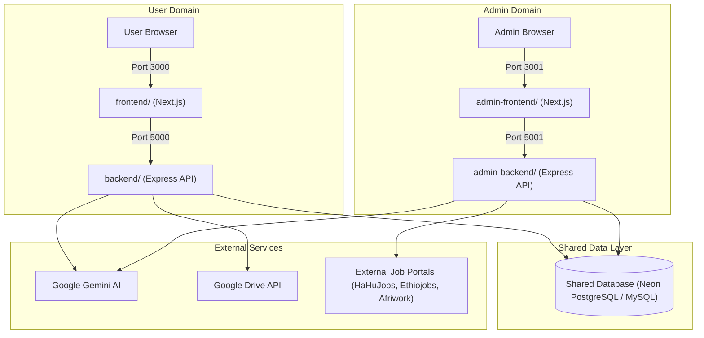

# Application Architecture Separation Plan

**Status:** Approved for Implementation  
**Date:** 2026-10-25  
**Objective:** Decompose the monolithic platform into four independent, decoupled applications while sharing the single canonical database:
1. `frontend/` — User-facing Next.js web application (Port 3000)
2. `backend/` — User-facing Express REST API (Port 5000)
3. `admin-frontend/` — Independent Next.js administration console (Port 3001)
4. `admin-backend/` — Dedicated Express administration and ingestion API (Port 5001)

---

## 1. Core Principles

- **Unified Account Identity:** Administrators use the exact same account credentials and database record as ordinary job seekers. No duplicate or shadow admin accounts are created.
- **Strict Role-Neutral User Experience:** When an administrator logs into `frontend/`, the experience is 100% indistinguishable from a regular job seeker. No admin badges, console links, role labels, or automatic redirects to `/admin` are rendered.
- **Server-Side Admin Authorization:** The `admin-frontend/` and `admin-backend/` enforce administrative permissions independently. Logging into `admin-frontend/` requires an explicit `ADMIN` role check on the server. Non-admin users are rejected with an access-denied notice.
- **Single Canonical Database:** Both backends (`backend/` and `admin-backend/`) connect to the same existing database (PostgreSQL / Neon or MySQL). No production data, existing tables, or records will be dropped or reset.
- **Dedicated Ingestion Authority:** The automated scraping scheduler and job-collection engine will run exclusively on `admin-backend/` (controlled via `ENABLE_SCHEDULER=true/false`) to prevent competing scraper runs and duplicate database writes.
- **Independent Session Lifecycles:** Admin sessions and user sessions use isolated tokens and cookies (`refreshToken` for user app vs `adminRefreshToken` for admin app), preventing unintended cross-application logout.

---

## 2. Target Application Topology

---

## 3. Separation Breakdown

### Application 1: `frontend/` (User Web Application)
- **Port:** `3000` (Default Next.js)
- **API Target:** `http://localhost:5000/api/v1`
- **Responsibilities:**
  - Public job search, filtering, and job details.
  - User registration, login, email verification, password reset.
  - Seeker profile management, experience, education, CV uploads.
  - Job application tracking pipeline (Kanban/table, interviews, reminders).
  - AI document studio (tailored CV & cover letter generation).
  - Saved searches & in-app notifications.
- **Adjustments:**
  - Strip all conditional `user.role === 'ADMIN'` checks from navbar, auth-card, login, and registration.
  - Remove all admin links, admin badges, and role labels (`{user.role}`).
  - Always redirect post-login to `/jobs` or safe user returnUrl.
  - Transition historical `/admin` routes to an informational migration message directing admins to `admin-frontend` at `http://localhost:3001`.

### Application 2: `backend/` (User REST API)
- **Port:** `5000`
- **Database:** Canonical shared database.
- **Responsibilities:**
  - User authentication (`/api/v1/auth/*`).
  - Job listings & taxonomy search (`/api/v1/jobs/*`).
  - Application tracker (`/api/v1/applications/*`).
  - Seeker profile & documents (`/api/v1/profile/*`, `/api/v1/documents/*`).
  - AI document generation (`/api/v1/ai-documents/*`).
  - Saved searches & notifications (`/api/v1/saved-searches/*`, `/api/v1/notifications/*`).
  - Public site settings (`/api/v1/settings`).
- **Adjustments:**
  - Remove admin moderation routes (`/api/v1/admin/*`, `/api/v1/admin/sources/*`) to keep backend lightweight and focused purely on user workflows.
  - Set `ENABLE_SCHEDULER=false` by default to avoid duplicate background polling.

### Application 3: `admin-frontend/` (Admin Web Console)
- **Port:** `3001`
- **API Target:** `http://localhost:5001/api/v1`
- **Responsibilities:**
  - Dedicated administrator authentication (`/login`).
  - Overview dashboard with real-time platform health metrics.
  - Job moderation & status transition (`/jobs`).
  - User governance & role assignment (`/users`).
  - Ingestion source controls & manual trigger execution (`/sources`).
  - AI classification review queue & manual overrides (`/classifications`).
  - System site settings & branding configuration (`/settings`).
  - Administrative audit log inspection (`/audit-logs`).
- **Design System:** Stormy Morning Dark palette (`slate-950` background, `slate-900` cards, `sky-400` primary accents).

### Application 4: `admin-backend/` (Admin & Ingestion API)
- **Port:** `5001`
- **Database:** Canonical shared database (shared Prisma schema).
- **Responsibilities:**
  - Dedicated admin authentication (`POST /api/v1/admin/auth/login`, `POST /api/v1/admin/auth/refresh`, `POST /api/v1/admin/auth/logout`, `GET /api/v1/admin/auth/verify`).
  - Enforces `authenticate` + `authorize('ADMIN')` on all operational endpoints.
  - Administrative operations (`/api/v1/admin/*`).
  - Ingestion sources management (`/api/v1/admin/sources/*`).
  - Dynamic source scheduler (`SourceScheduler`) active here (`ENABLE_SCHEDULER=true`).
  - Scraper adapters (HaHuJobs, Ethiojobs, Afriwork).
  - Background alert evaluation worker.

---

## 4. Shared Database & Migration Governance

To avoid schema drift or competing migrations:
- **Canonical Schema Master:** `backend/prisma` maintains the canonical schemas (`schema.postgresql.prisma` and `schema.mysql.prisma`).
- **Admin Backend Schema:** `admin-backend/` shares the canonical schema via synchronization or direct reference, running `prisma generate` to compile the Prisma Client.
- **Migration Policy:** Schema migrations (`prisma migrate`) are run exclusively through the canonical schema master. Production tables are never dropped or recreated.

---

## 5. Verification & Acceptance Testing Plan

1. **Scenario A (Admin in User App):** Admin logs into `frontend/` -> lands on `/jobs` -> sees standard seeker navigation -> no admin console links or role badges appear.
2. **Scenario B (Admin in Admin App):** Admin logs into `admin-frontend/` -> backend verifies `ADMIN` role -> lands on `/` admin dashboard -> can access governance operations.
3. **Scenario C (Normal User in Admin App):** Standard user attempts login on `admin-frontend/` -> admin backend rejects with 403 Forbidden -> generic access-denied message shown -> normal account remains intact.
4. **Scenario D (Direct API Access):** Unauthenticated, non-admin, or forged token requests to `admin-backend/` are rejected with 401 or 403 by server-side authorization.
5. **Shared Database & Ingestion Integrity:** Both backends read and write to the same database. Background ingestion runs smoothly without duplication.

