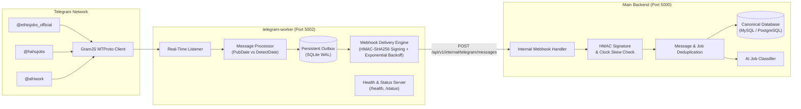

# Telegram Ingestion Server (`telegram-worker`)

An independent real-time Telegram channel ingestion worker for the Ethiopian Job Platform. Built with **GramJS (`telegram`)**, **Node.js**, **Express**, and a persistent SQLite-backed **Outbox Engine** to deliver verified vacancy posts to the canonical backend API without data loss.

---

## Architecture Overview



---

## Key Features

1. **Persistent Session via GramJS**: Uses MTProto `StringSession` to authenticate once without needing SMS/code prompts on restarts.
2. **Channel Authorization Enforcement**: Only processes messages from verified authorized channels; ignores all untrusted sources.
3. **Publication vs Detection Timestamps**: Preserves original Telegram publication timestamp (`publishedAt`) separately from worker detection time (`detectedAt`).
4. **Persistent Outbox Guarantee**: Messages are saved to SQLite (`sessions/outbox.db`) *before* delivery, preventing lost messages during backend downtime or restarts.
5. **HMAC-SHA256 Request Signing**: All internal webhooks are cryptographically signed with timestamp verification to prevent replay attacks and unauthorized calls.
6. **Exponential Backoff & Rate Limit Handling**: Handles HTTP 429 (`Retry-After`), server errors (5xx), and network timeouts with randomized jitter.
7. **Zero Impact on Publishing Bot**: Completely separate from the outbound Telegram publisher bot.

---

## Directory Structure

```
telegram-worker/
├── package.json
├── .env.example
├── README.md
├── sessions/                # Ignored: persistent outbox & session strings
│   ├── outbox.db
│   └── gramjs.session
├── src/
│   ├── index.js             # Worker bootstrap & graceful shutdown
│   ├── config/
│   │   └── env.js           # Environment validation
│   ├── telegram/
│   │   ├── client.js        # GramJS client & session management
│   │   ├── listener.js      # Real-time event listener
│   │   └── channels.js      # Channel registry & authorization cache
│   ├── services/
│   │   └── messageProcessor.js # Metadata extraction & normalization
│   ├── storage/
│   │   └── outbox.js        # SQLite-backed transactional outbox
│   ├── delivery/
│   │   ├── webhook.js       # Outbox delivery worker & HMAC signer
│   │   └── retry.js         # Exponential backoff & status evaluator
│   ├── health/
│   │   └── server.js        # /health and /status endpoints
│   └── utils/
│       └── logger.js        # Structured sanitized logging
└── tests/
    ├── outbox.test.js
    ├── retry.test.js
    └── messageProcessor.test.js
```

---

## Quickstart & Local Development

### 1. Install Dependencies
```bash
cd telegram-worker
npm install
```

### 2. Configure Environment
```bash
cp .env.example .env
```
Populate:
- `TELEGRAM_API_ID` & `TELEGRAM_API_HASH` (from [my.telegram.org](https://my.telegram.org))
- `TELEGRAM_SESSION` (StringSession from your authorized Telegram account)
- `BACKEND_URL` (`http://localhost:5000`)
- `INTERNAL_API_SECRET` (matches `TELEGRAM_INTERNAL_API_SECRET` in `backend/.env`)

### 3. Run Development Server
```bash
npm run dev
```

### 4. Operational Endpoints
- **Liveness probe**: `http://localhost:5002/health`
- **Detailed status**: `http://localhost:5002/status`

---

## Deployment (Render / VPS / Docker)

1. Deploy as a persistent background worker (e.g. Render Background Worker or systemd service).
2. Attach a persistent disk mount to `/sessions` so `outbox.db` and session strings survive container redeployments.
3. Set `PORT=5002` and ensure `BACKEND_URL` points to your backend internal address.
